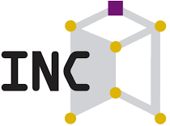
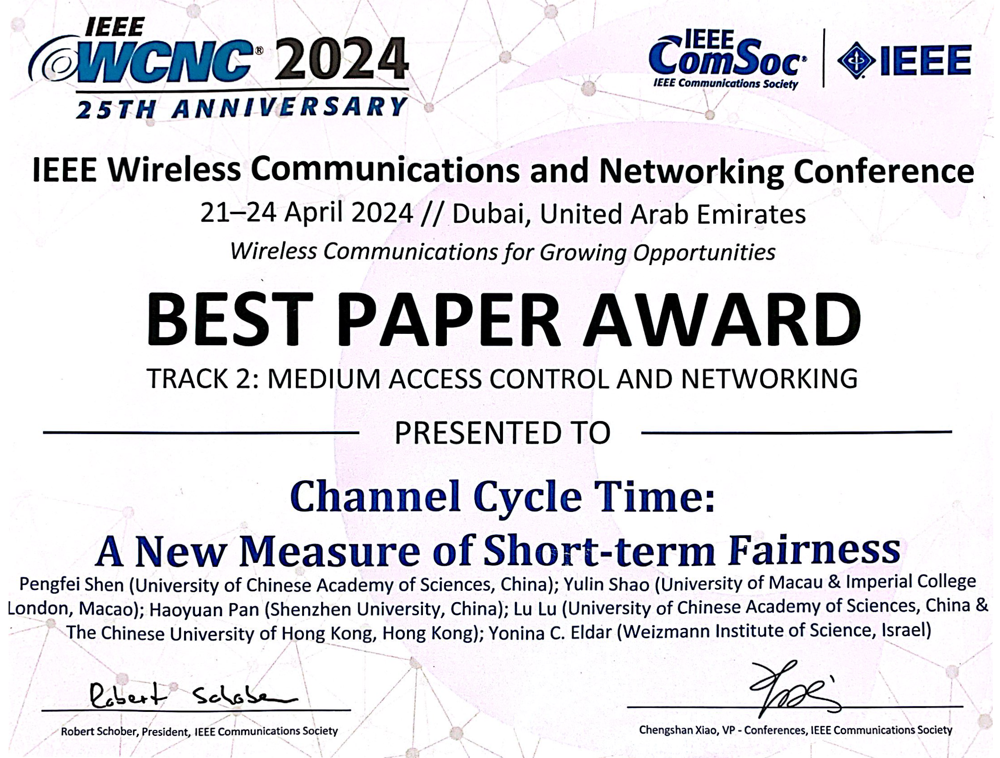
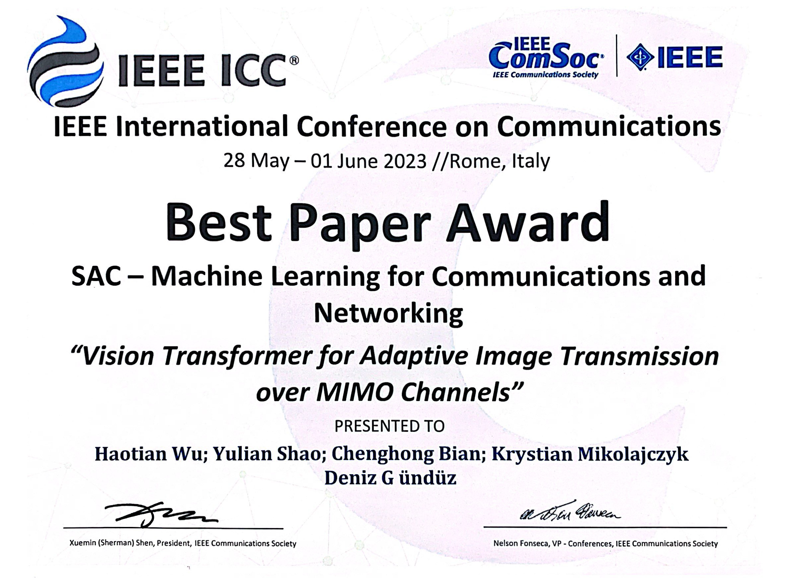
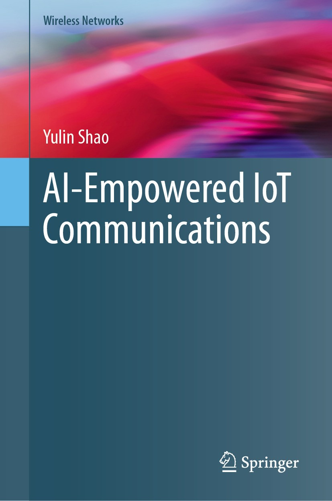
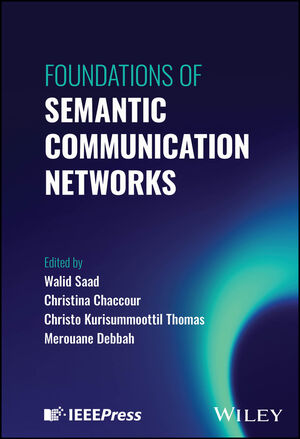

<!-- 需要纯CSS解决方案 -->

  <!-- 英文段落1 -->
  

    

The physical world leaves its signature on waves. As waves propagate and interact with their surroundings, they reveal the structure and dynamics of the environment while carrying information across space. This makes waves a fundamental interface between intelligence and the physical world.
    

  

  <!-- 英文段落2 -->
  

    
  
At the Wave Intelligence Lab, we explore the deep interplay between waves and intelligence. We develop intelligent methods to understand, model, and engineer wave phenomena, while harnessing waves to extend how intelligent systems perceive, learn about, and interact with the world. By bringing together wave physics, AI, signal processing, and information theory, we seek to uncover fundamental principles and develop technologies that connect intelligence with physical reality.
    

  

  <!-- 英文段落2 -->
  

    

 Our vision is a world where intelligence is deeply grounded in physical reality, empowered by waves to understand its surroundings, interact with its environment, and act upon what it learns.
    

  

  <!-- 最后一句英文（特殊样式） -->
  

    

      Here, we bridge theory and application, today and tomorrow.
    

  

---

# About the Supervisor
<!-- Current Academic Appointment -->

  

    <!-- Academic Information -->
    

      <h2 style="margin: 0 0 7px; font-size: 26px; line-height: 1.25; font-weight: 600; letter-spacing: -0.02em; color: #24292e;">
        Dr. Yulin Shao
      </h2>

      

        Assistant Professor
      

      

        Department of Electrical and Electronic Engineering
      

      

        The University of Hong Kong
      

      

        <a href="mailto:ylshao@hku.hk" style="color: #0366d6; text-decoration: none;">
          ylshao@hku.hk
        </a>
      

    

    <!-- University Logo -->
    

      
    

  

  
  <!-- 经历部分标题 -->
  <h2 style="color: #24292e; font-size: 24px; font-weight: 600; margin: 40px 0 30px 0; padding-bottom: 12px; border-bottom: 3px solid #0366d6; display: flex; align-items: center;">
    <svg width="24" height="24" viewBox="0 0 24 24" fill="none" stroke="#0366d6" style="margin-right: 12px;">
      <path d="M20 21v-2a4 4 0 0 0-4-4H8a4 4 0 0 0-4 4v2"></path>
      <circle cx="12" cy="7" r="4"></circle>
    </svg>
    Academic Background
  </h2>
  
  <!-- 时间线经历 -->
  

    <!-- 时间线竖线 -->
    

    
    <!-- 经历项 -2 -->
    

      

      
      

        

          

            <h3 style="margin: 0 0 5px 0; color: #24292e; font-size: 16px; font-weight: 600;">B.S. & M.S.</h3>
            
Xidian University

            
Communications and Information Engineering

          

          

            
          

        

      

    

    
    <!-- 经历项 -1 -->
    

      

      
      

        

          

            <h3 style="margin: 0 0 5px 0; color: #24292e; font-size: 16px; font-weight: 600;">Ph.D.</h3>
            
The Chinese University of Hong Kong

            
Information Engineering

          

          

            
          

        

      

    

    
    
    <!-- 经历项 6 -->
    

      

      
      

        

          

            <h3 style="margin: 0 0 5px 0; color: #24292e; font-size: 16px; font-weight: 600;">Research Assistant</h3>
            
Institute of Network Coding

          

          

            
          

        

      

    

    <!-- 经历项 5 -->
    

      

      
      

        

          

            <h3 style="margin: 0 0 5px 0; color: #24292e; font-size: 16px; font-weight: 600;">Visiting Scholar</h3>
            
Massachusetts Institute of Technology

            
Claude E. Shannon Communication and Network Group

          

          

            
          

        

      

    

    
    <!-- 经历项 4 -->
    

      

      
      

        

          

            <h3 style="margin: 0 0 5px 0; color: #24292e; font-size: 16px; font-weight: 600;">Research Associate</h3>
            
Imperial College London

            
Department of Electrical and Electronic Engineering

          

          

            
          

        

      

    

    
    <!-- 经历项 3 -->
    

      

      
      

        

          

            <h3 style="margin: 0 0 5px 0; color: #24292e; font-size: 16px; font-weight: 600;">Lecturer (AP) in Information Processing</h3>
            
University of Exeter

            
Department of Engineering

          

          

            
          

        

      

    

    
    <!-- 经历项 2 -->
    

      

      
      

        

          

            <h3 style="margin: 0 0 5px 0; color: #24292e; font-size: 16px; font-weight: 600;">Assistant Professor</h3>
            
University of Macau

            
IOTSC State Key Laboratory

          

          

            
          

        

      

    

    
    <!-- 经历项 1 -->
    

      

      
      

        

          

            <h3 style="margin: 0 0 5px 0; color: #24292e; font-size: 16px; font-weight: 600;">Visiting Researcher</h3>
            
Imperial College London

            
Department of Electrical and Electronic Engineering

          

          

            
          

        

      

    

    
  

  

  
  <!-- 服务部分标题 -->
  <h2 style="color: #24292e; font-size: 24px; font-weight: 600; margin: 40px 0 20px 0; padding-bottom: 12px; border-bottom: 3px solid #0366d6; display: flex; align-items: center;">
    <svg width="24" height="24" viewBox="0 0 24 24" fill="none" stroke="#0366d6" style="margin-right: 12px;">
      <path d="M20 21v-2a4 4 0 0 0-4-4H8a4 4 0 0 0-4 4v2"></path>
      <circle cx="12" cy="7" r="4"></circle>
    </svg>
    Professional Services
  </h2>
  
  <!-- 服务时间线 -->
  

    <!-- 时间线竖线 -->
    

    
    <!-- 服务 -1 -->
    

      

      

        

          

            

              <h3 style="margin: 0; color: #24292e; font-size: 15px; font-weight: 600; margin-right: 10px;">Founding Secretary</h3>
              
Public Safety Communication TWG,  IEEE ComSoc 

            

          

        

      

    

    
    <!-- 服务 0 -->
    

      

      

        

          

            

              <h3 style="margin: 0; color: #24292e; font-size: 15px; font-weight: 600; margin-right: 10px;">Committee Member</h3>
              
Information Theory Society, Chinese Institute of Electronics (CIE)

            

          

        

      

    

    
    <!-- 服务 1 -->
    

      

      
      

        

          

            

              <h3 style="margin: 0; color: #24292e; font-size: 15px; font-weight: 600; margin-right: 10px;">Associate Editor</h3>
              
IEEE Communications Magazine

            

          

        

      

    

    
    <!-- 服务 2 -->
    

      

      
      

        

          

            

              <h3 style="margin: 0; color: #24292e; font-size: 15px; font-weight: 600; margin-right: 10px;">Associate Editor</h3>
              
IEEE Transactions on Wireless Communications

            

          

        

      

    

    
    <!-- 服务 3 -->
    

      

      
      

        

          

            

              <h3 style="margin: 0; color: #24292e; font-size: 15px; font-weight: 600; margin-right: 10px;">Associate Editor</h3>
              
IEEE Transactions on Communications

            

          

        

      

    

    
    <!-- 服务 4 -->
    

      

      
      

        

          

            

              <h3 style="margin: 0; color: #24292e; font-size: 15px; font-weight: 600; margin-right: 10px;">Associate Editor</h3>
              
IEEE Communications Letters

            

          

        

      

    

    
    <!-- 服务 5 -->
    

      

      
      

        

          

            

              <h3 style="margin: 0; color: #24292e; font-size: 15px; font-weight: 600; margin-right: 10px;">Session chair and TPC member</h3>
              
IEEE Communication Society flagship conferences

            

          

        

      

    

    
    <!-- 服务 6 -->
    

      

      
      

        

          

            

              <h3 style="margin: 0; color: #24292e; font-size: 15px; font-weight: 600; margin-right: 10px;">Guest Lecturer</h3>
              
5G Academy Italy

            

          

        

      

    

    
    <!-- 服务 7 -->
    

      

      
      

        

          

            

              <h3 style="margin: 0; color: #24292e; font-size: 15px; font-weight: 600; margin-right: 10px;">Guest Lecturer</h3>
              
IEEE Information Theory Society Bangalore Chapter

            

          

        

      

    

    
  

<!--
# Research Interests

* Fundamentals of wireless communications
  * Tools: signal processing, matrix theory, real analysis, information theory.
* Data science and machine learning
  * Tools: deep learning, variational Bayesian methods, statistical inference.
* Networking and stochastic control
  * Tools: Markov decision process theory, reinforcement learning, optimization.

I am particularly drawn to two types of problems: 1) problems that yield fundamental insights; 2) problems that are grounded in practical applications or have practical value.

My recent research endeavors focus on: 1) exploring deep learning techniques to achieve new breakthroughs in wireless communications, networking, and control; 2) developing new designs for wireless links and networks to enhance support for machine learning applications.
-->

  
  <!-- 奖项部分标题 -->
  <h2 style="color: #24292e; font-size: 24px; font-weight: 600; margin: 40px 0 25px 0; padding-bottom: 12px; border-bottom: 3px solid #0366d6; display: flex; align-items: center;">
    <svg width="24" height="24" viewBox="0 0 24 24" fill="none" stroke="#0366d6" style="margin-right: 12px;">
      <path d="M12 15l8-8-8 8-8-8 8 8z"></path>
      <path d="M20 12v7a2 2 0 0 1-2 2H6a2 2 0 0 1-2-2v-7"></path>
      <path d="M12 22V12"></path>
    </svg>
    Achievements and Awards
  </h2>
  
  <!-- 奖项-1 -->
  

    

      

      <h3 style="margin: 0 0 8px 0; color: #24292e; font-size: 16px; font-weight: 600;">IEEE Senior Member</h3>
      

      

    

    <!-- 

      
    
 -->
  

  
  <!-- 奖项0 -->
  

    

      

      <h3 style="margin: 0 0 8px 0; color: #24292e; font-size: 16px; font-weight: 600;">Best Paper Award</h3>
      
IEEE Global Communications Conference (GLOBECOM) 2026

      
Macau, China

    

    <!-- 

      
    
 -->
  

  
  <!-- 奖项1 -->
  

    

      

      <h3 style="margin: 0 0 8px 0; color: #24292e; font-size: 16px; font-weight: 600;">Best Paper Award</h3>
      
IEEE Wireless Communications and Networking Conference (WCNC) 2024

      
Dubai, United Arab Emirates

    

    

      
    

  

  
  <!-- 奖项2 -->
  

    

      

      <h3 style="margin: 0 0 8px 0; color: #24292e; font-size: 16px; font-weight: 600;">Best Paper Award</h3>
      
IEEE International Conference on Communications (ICC) 2023

      
Rome, Italy

    

    

      
    

  

  
  <!-- 奖项3 -->
  

    

      

      <h3 style="margin: 0 0 8px 0; color: #24292e; font-size: 16px; font-weight: 600;">Best Poster Award</h3>
      
CIE Information Theory Society 2023

      
Nanjing, China

    

    

      
    

  

  
  <!-- 其他奖项列表 -->
  

    
    <!-- 奖项3 -->
    

      

      

        <h3 style="margin: 0 0 6px 0; color: #24292e; font-size: 16px; font-weight: 600;">International Telecommunication Union (ITU) AI/ML in 5G Challenge 2021</h3>
        
Ranked third in problem "Federated learning for spatial reuse"

        
Nominated as a finalist in the Grand Challenge Finale

      

    

    
    <!-- 奖项4 -->
    

      

      

        <h3 style="margin: 0 0 6px 0; color: #24292e; font-size: 16px; font-weight: 600;">Global scholarship programme for research excellence</h3>
        
2019

      

    

    
    <!-- 奖项5 -->
    

      

      

        <h3 style="margin: 0 0 6px 0; color: #24292e; font-size: 16px; font-weight: 600;">Overseas research attachment programme</h3>
        
2018

      

    

    
  

  

  
  <!-- 书籍部分标题 -->
  <h2 style="color: #24292e; font-size: 24px; font-weight: 600; margin: 40px 0 20px 0; padding-bottom: 12px; border-bottom: 3px solid #0366d6; display: flex; align-items: center;">
    <svg width="24" height="24" viewBox="0 0 24 24" fill="none" stroke="#0366d6" style="margin-right: 12px;">
      <path d="M4 19.5A2.5 2.5 0 0 1 6.5 17H20"></path>
      <path d="M6.5 2H20v20H6.5A2.5 2.5 0 0 1 4 19.5v-15A2.5 2.5 0 0 1 6.5 2z"></path>
    </svg>
    Books
  </h2>
  
  <!-- 书籍列表 -->
  

    
    <!-- 书籍 1 -->
    

      

        <!-- 封面图片 -->
        

          
        

        <!-- 书籍信息 -->
        

          

            <h3 style="margin: 0; color: #24292e; font-size: 16px; font-weight: 600; line-height: 1.4;">AI-Empowered IoT Communications</h3>
            2025
          

          
Springer Nature

          

            

              Author: 
              Yulin Shao
            

          

        

      

    

    
    <!-- 书籍 2 -->
    

      

        <!-- 封面图片 -->
        

          
        

        <!-- 书籍信息 -->
        

          

            

              <h3 style="margin: 0; color: #24292e; font-size: 16px; font-weight: 600; line-height: 1.4;">Book chapter: Deep Joint Source and Channel Coding</h3>
              
Foundations of Semantic Communication Networks

            

            2024
          

          
Wiley

          

            

              Authors: 
              Haotian Wu, Chenghong Bian, Yulin Shao, Deniz Gündüz
            

          

        

      

    

    
  

  

  
  <!-- 出版物标题 -->
  <h2 style="color: #24292e; font-size: 24px; font-weight: 600; margin: 40px 0 20px 0; padding-bottom: 12px; border-bottom: 3px solid #0366d6; display: flex; align-items: center;">
    <svg width="24" height="24" viewBox="0 0 24 24" fill="none" stroke="#0366d6" style="margin-right: 12px;">
      <path d="M4 19.5A2.5 2.5 0 0 1 6.5 17H20"></path>
      <path d="M6.5 2H20v20H6.5A2.5 2.5 0 0 1 4 19.5v-15A2.5 2.5 0 0 1 6.5 2z"></path>
    </svg>
    Selected Publications
  </h2>
  
  <!-- 出版物列表 -->
  

    
    <!-- 出版物 0 -->
    

      

      

        <strong style="color: #24292e;">Y. Shao</strong>. 
        Embodied Communication: Sensing-Induced Reliability Fields and Capacity Bounds. 
        arXiv:2605.08284, 
        <strong style="color: #586069;">2026</strong>.
      

    

    
    <!-- 出版物 1 -->
    

      

      

        <strong style="color: #24292e;">Y. Shao</strong>. 
        DEEP-IoT: Downlink-Enhanced Efficient-Power Internet of Things. 
        IEEE Transactions on Wireless Communications, 
        vol. 24, no. 2, pp. 1722-1736, 
        <strong style="color: #586069;">2025</strong>.
      

    

    
    <!-- 出版物 2 -->
    

      

      

        <strong style="color: #24292e;">Y. Shao, C. Bian, L. Yang, Q. Yang, Z. Zhang, D. Gunduz</strong>. 
        Point Cloud in the Air. 
        IEEE Communications Magazine, 
        vol. 36, no. 12, pp. 142-148, 
        <strong style="color: #586069;">2025</strong>.
      

    

    
    <!-- 出版物 3 -->
    

      

      

        <strong style="color: #24292e;">Y. Shao, Q. Cao, and D. Gunduz</strong>. 
        A Theory of Semantic Communication. 
        IEEE Transactions on Mobile Computing, 
        vol. 23, no. 12, pp. 12211-12228, 
        <strong style="color: #586069;">2024</strong>.
      

    

    
    <!-- 出版物 4 -->
    

      

      

        <strong style="color: #24292e;">Y. Shao, Y. Cai, T. Wang, Z. Guo, P. Liu, J. Luo, D. Gunduz</strong>. 
        Learning-based autonomous channel access in the presence of hidden terminals. 
        IEEE Transactions on Mobile Computing, 
        vol. 23, no. 5, pp. 3680-3695, 
        <strong style="color: #586069;">2024</strong>.
      

    

    
    <!-- 出版物 5 -->
    

      

      

        <strong style="color: #24292e;">Y. Shao, S. Liew and D. Gunduz</strong>. 
        Denoising noisy neural networks: A Bayesian approach with compensation. 
        IEEE Transactions on Signal Processing, 
        vol. 71, pp. 2460-2474, 
        <strong style="color: #586069;">2023</strong>.
      

    

    
    <!-- 出版物 6 -->
    

      

      

        <strong style="color: #24292e;">Y. Shao, D. Gunduz and S. Liew</strong>. 
        Bayesian over-the-air computation. 
        IEEE Journal on Selected Areas in Communications, 
        vol. 41, no. 3, pp. 589-606, 
        <strong style="color: #586069;">2023</strong>.
      

    

    
    <!-- 出版物 7 -->
    

      

      

        <strong style="color: #24292e;">Y. Shao, D. Gunduz and S. Liew</strong>. 
        Federated edge learning with misaligned over-the-air computation. 
        IEEE Transactions on Wireless Communications, 
        vol. 21, no. 6, pp. 3951-3964, 
        <strong style="color: #586069;">2022</strong>.
      

    

    
    <!-- 出版物 8 -->
    

      

      

        <strong style="color: #24292e;">Y. Shao, D. Gunduz</strong>. 
        Semantic communications with discrete-time analog transmission: a PAPR perspective. 
        IEEE Wireless Communication Letter, 
        <strong style="color: #586069;">2022</strong>.
      

    

    
    <!-- 出版物 9 -->
    

      

      

        <strong style="color: #24292e;">Y. Shao</strong>. 
        Goal-oriented communication system redesign for wireless collaborative intelligence. 
        IEEE Multimedia Communication Technical Committee – Frontiers, 
        <strong style="color: #586069;">2022</strong>.
      

    

    
    <!-- 出版物 10 -->
    

      

      

        <strong style="color: #24292e;">Y. Shao, Q. Cao, S. Liew, and H. Chen</strong>. 
        Partially observable minimum-age scheduling: the greedy policy. 
        IEEE Transactions on Communications, 
        vol. 70, no. 1, pp. 404-418, 
        <strong style="color: #586069;">2021</strong>.
      

    

    
    <!-- 出版物 11 -->
    

      

      

        <strong style="color: #24292e;">Y. Shao, S. Liew, H. Chen, Y. Du</strong>. 
        Flow sampling: network monitoring in large-scale software-defined IoT networks. 
        IEEE Transactions on Communications, 
        vol. 69, no. 9, pp. 6120-6133, 
        <strong style="color: #586069;">2021</strong>.
      

    

    
    <!-- 出版物 12 -->
    

      

      

        <strong style="color: #24292e;">Y. Shao and S. Liew</strong>. 
        Flexible subcarrier allocation for interleaved frequency division multiple access. 
        IEEE Transactions on Wireless Communications, 
        vol. 19, no. 11, pp. 7139-7152, 
        <strong style="color: #586069;">2020</strong>.
      

    

    
    <!-- 出版物 13 -->
    

      

      

        <strong style="color: #24292e;">Y. Shao, A. Rezaee, S. Liew, and V. Chan</strong>. 
        Significant sampling for shortest path routing: a deep reinforcement learning solution. 
        IEEE Journal on Selected Areas in Communications, 
        vol. 38, no. 10, pp. 2234–2248, 
        <strong style="color: #586069;">2020</strong>.
      

    

    
    <!-- 出版物 14 -->
    

      

      

        <strong style="color: #24292e;">Y. Shao, S. Liew, and J. Liang</strong>. 
        Sporadic ultra-time-critical crowd messaging in V2X. 
        IEEE Transactions on Communications, 
        vol. 69, no. 2, pp. 817-830, 
        <strong style="color: #586069;">2020</strong>.
      

    

    
    <!-- 出版物 15 -->
    

      

      

        <strong style="color: #24292e;">Y. Shao, S. Liew, and T. Wang</strong>. 
        AlphaSeq: sequence discovery with deep reinforcement learning. 
        IEEE Transactions on Neural Networks and Learning Systems, 
        vol. 31, no. 9, pp. 3319–3333, 
        <strong style="color: #586069;">2019</strong>.
      

    

    
    <!-- 出版物 16 -->
    

      

      

        <strong style="color: #24292e;">Y. Shao, S. Liew, and L. Lu</strong>. 
        Asynchronous physical-layer network coding: symbol misalignment estimation and its effect on decoding. 
        IEEE Transactions on Wireless Communications, 
        vol. 16, no. 10, pp. 6881–6894, 
        <strong style="color: #586069;">2017</strong>.
      

    

    
  

  

<!--
# Selected Journal Publications

* Y. Shao. DEEP-IoT: Downlink-Enhanced Efficient-Power Internet of Things, IEEE Transactions on Wireless Communications, vol. 24, no. 2, pp. 1722-1736, 2025.
  
* Y. Shao, C. Bian, L. Yang, Q. Yang, Z. Zhang, D. Gunduz, Point Cloud in the Air, IEEE Communications Magazine, vol. 36, no. 12, pp. 142-148, 2025.

* Y. Shao, Q. Cao, and D. Gunduz. A Theory of Semantic Communication, IEEE Transactions on Mobile Computing, vol. 23, no. 12, pp. 12211-12228, 2024.
  
* Y. Shao, Y. Cai, T. Wang, Z. Guo, P. Liu, J. Luo, D. Gunduz. Learning-based autonomous channel access in the presence of hidden terminals, IEEE Transactions on Mobile Computing, vol. 23, no. 5, pp. 3680-3695, 2024.

* Y. Shao, S. Liew and D. Gunduz. Denoising noisy neural networks: A Bayesian approach with compensation, IEEE Transactions on Signal Processing, vol. 71, pp. 2460-2474, 2023.

* Y. Shao, D. Gunduz and S. Liew. Bayesian over-the-air computation, IEEE Journal on Selected Areas in Communications, vol. 41, no. 3, pp. 589-606, 2023.

* Y. Shao, D. Gunduz and S. Liew. Federated edge learning with misaligned over-the-air computation,” IEEE Transactions on Wireless Communications, vol. 21, no. 6, pp. 3951-3964, 2022.

* Y. Shao, D. Gunduz. Semantic communications with discrete-time analog transmission: a PAPR perspective,” IEEE Wireless Communication Letter, 2022.

* Y. Shao. Goal-oriented communication system redesign for wireless collaborative intelligence, IEEE Multimedia Communication Technical Committee – Frontiers, 2022.

* Y. Shao, Q, Cao, S. Liew, and H. Chen. Partially observable minimum-age scheduling: the greedy policy, IEEE Transactions on Communications, vol. 70, no. 1, pp. 404-418, 2021.

* Y. Shao, S. Liew, H. Chen, Y. Du. Flow sampling: network monitoring in large-scale software-defined IoT networks, IEEE Transactions on Communications, vol. 69, no. 9, pp. 6120-6133, 2021.

* Y. Shao and S. Liew. Flexible subcarrier allocation for interleaved frequency division multiple access, IEEE Transactions on Wireless Communications, vol. 19, no. 11, pp. 7139-7152, 2020.

* Y. Shao, A. Rezaee, S. Liew, and V. Chan. Significant sampling for shortest path routing: a deep reinforcement learning solution, IEEE Journal on Selected Areas in Communications, vol. 38, no. 10, pp. 2234–2248, 2020.

* Y. Shao, S. Liew, and J. Liang. Sporadic ultra-time-critical crowd messaging in V2X, IEEE Transactions on Communications, vol. 69, no. 2, pp. 817-830, 2020.

* Y. Shao, S. Liew, and T. Wang. AlphaSeq: sequence discovery with deep reinforcement learning, IEEE Transactions on Neural Networks and Learning Systems, vol. 31, no. 9, pp. 3319–3333, 2019.

* Y. Shao, S. Liew, and L. Lu. Asynchronous physical-layer network coding: symbol misalignment estimation and its effect on decoding, IEEE Transactions on Wireless Communications, vol. 16, no. 10, pp. 6881–6894, 2017.
-->

